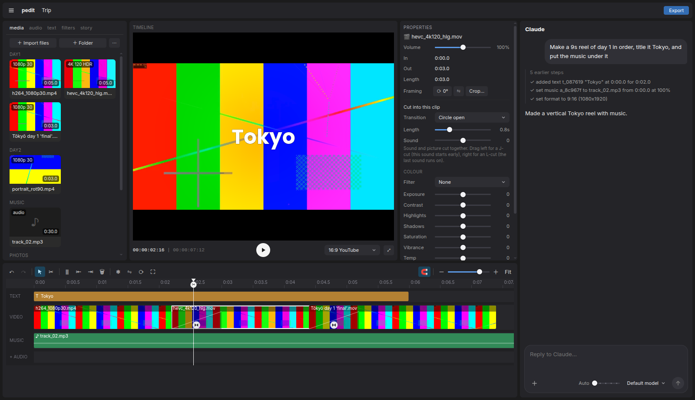
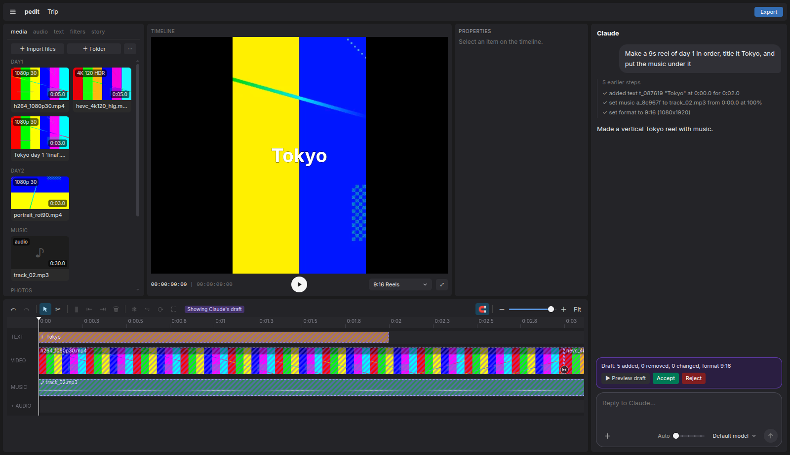
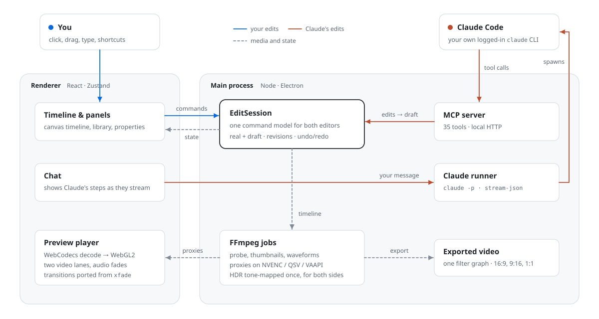

<div align="center">

# pedit

**A desktop video editor that Claude can drive.**

Tell it *"make a 30-second reel of day 1, title it Tokyo, put the music under it"*. Claude cuts the timeline for you, and you review the result as a draft before keeping it.




</div>

## What it is

pedit is a CapCut-style editor for Linux, built from scratch. It has a media library, a multi-track timeline, real-time preview, titles, filters, transitions and export. On the right is a chat panel connected to **Claude Code**. pedit runs its own **MCP server**, so Claude edits the project with the same commands the mouse uses. Every change Claude makes lands in a **draft** that you can preview, accept or reject.



## Features

**Editing**
- Ripple video track, plus text, music and extra audio rows. Trim, split, blade tool, duplicate, freeze frame, undo/redo
- 18 transitions (fades, wipes, slides, circles, zoom) with a length you choose. J- and L-cuts let the sound lead or trail the picture
- 15 colour filters, plus exposure, contrast, white balance, split toning, vignette and LUT import
- Text with 15 ready-made styles, bundled fonts (including Devanagari), outlines, shadows and in/out animations
- Crop, rotate, mirror, and 16:9 / 9:16 / 1:1 output

**Media**
- Imports 4K, 120 fps, HEVC, HDR (HLG/PQ), rotated phone clips and photos
- Background proxies use hardware encoders (NVENC / QSV / VAAPI) with an x264 fallback. HDR is tone-mapped the same way for preview and export, so they match
- Thumbnails, waveforms, and capture-date ordering

**Preview and export**
- A WebGL2 compositor decodes frames with WebCodecs (Mediabunny), keeps two video lanes for overlaps, and schedules audio with smooth fades
- Transition shaders port FFmpeg's `xfade` formulas. A test checks that the preview and the exported file match pixel for pixel, within a small tolerance
- Export builds a single FFmpeg filter graph, so it stays correct no matter how complex the timeline is

**Claude integration**
- 35 MCP tools ([list below](#mcp-tools)). Claude reads the timeline, makes edits, and can **look** at clips and at its own finished edit (a contact sheet rendered with the export pipeline) to check its work
- Optimistic concurrency: every edit carries the timeline revision, so stale edits are refused instead of overwriting yours
- Draft, accept or reject, with a diff of what Claude added, removed and changed
- An editor guide teaches Claude pacing, cut types and when a transition earns its place. Each project can have its own `story.md` brief
- Model picker and an Effort button that opens a slider. Drop any file on the chat (clips, photos, music, a story, subtitles, LUTs and more), or mention clips with `@`. Replies are formatted (lists, code, tables)

## How it works



- **One command model.** Every edit, whether from a click, a shortcut or Claude, is a pure command in `src/shared/commands.ts`, applied by an `EditSession`. That one design gives you undo/redo, drafts, revision checks and Claude's edit summaries.
- **The preview matches the export.** Tone mapping, filters, text layout and transitions are each written once and shared, or ported from FFmpeg and checked by tests.
- **Claude Code does the reasoning.** pedit spawns your own logged-in `claude` CLI with an MCP config that points at pedit's local server, then streams its steps into the chat. pedit never handles API keys.

## MCP tools

| Area | Tools |
|---|---|
| Read | `get_timeline`, `list_media`, `get_project_settings`, `get_story` |
| See | `look_at_media` (frames of a clip), `look_at_timeline` (contact sheet of the rendered edit) |
| Clips | `add_clip`, `remove_item`, `move_item`, `trim_item`, `split_item`, `duplicate_item`, `replace_clip`, `freeze_frame`, `set_transform` |
| Audio | `set_music`, `set_volume`, `extract_audio`, `set_audio_cut` |
| Text | `add_text`, `update_text`, `add_captions`, `restyle_text`, `list_text_styles`, `save_text_style`, `list_fonts`, `add_font` |
| Colour | `apply_filter`, `adjust_color`, `list_filters`, `create_filter`, `import_lut` |
| Cuts | `list_transitions`, `set_transition` |
| Output | `set_format` |

## Getting started

Linux x64. You need Node.js 22 or newer, and the [Claude Code](https://claude.com/claude-code) CLI logged in for the chat features.

```bash
git clone https://github.com/Prathmeshgumal/pedit.git
cd pedit
npm install
npm run fetch-ffmpeg   # downloads a static FFmpeg 8 build into resources/ffmpeg
npm run dev
```

Build a standalone AppImage:

```bash
npm run dist           # → dist/pedit-0.1.0.AppImage
```

## Testing

```bash
npm test               # 213 unit tests (Vitest): commands, sessions, MCP tools, export graphs
npm run typecheck
npm run fixtures       # generates the test media (4K120 HDR, rotated, photos, music)
npm run e2e            # 44 end-to-end tests (Playwright driving the real Electron app)
```

The end-to-end tests use a scripted stand-in for Claude (`tests/fake-claude`) that talks to the real MCP server. They cover import, playback frame rates, seeking, the draft flow, every panel, and **preview-vs-export pixel comparisons** for transitions, filters and text.

## Project layout

```
src/
  main/        Electron main: MCP server, Claude runner, FFmpeg media jobs, export graph, project store
  renderer/    React UI: panels, canvas timeline, WebGL2 preview player, chat
  shared/      Pure, tested core: data model, commands, edit session, presets
  preload/     IPC bridge
tests/         Vitest unit tests, Playwright e2e, fake Claude
docs/          Roadmap, design notes, benchmarks
```
